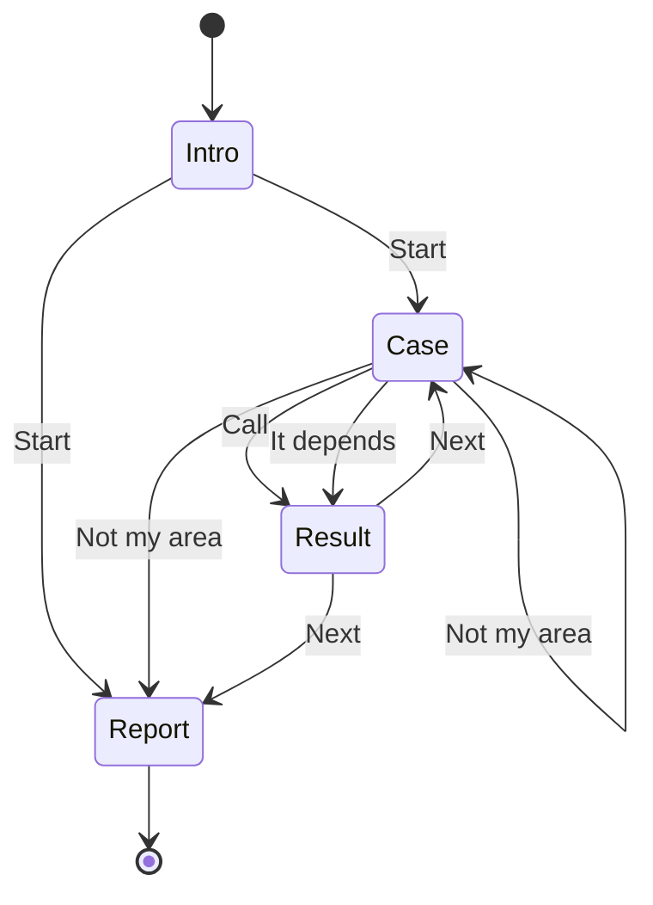

<!-- Generated by `lake exe specs` from the compiled model. Change the model, not this file. -->

# Design Document: A shift of review cases

## Overview

One expert moves through a short run of cases. These requirements describe every screen and every action.

## Data models

Read from the compiled Lean types.

- `Phase`, one of: `intro`, `asking`, `revealed`, `done`
- `Event`, one of: `start`, `call`, `depends`, `notMine`, `next`
- `Session`, a structure: `phase: Game.Phase`, `index: Nat`, `length: Nat`
- `Screen`, one of: `intro`, `face`, `reveal`, `report`

## State table

Computed by running `Session.step`.
| Screen | Action | Result |
| --- | --- | --- |
| Intro (the shift has cases) | Start | show the first case |
| Intro (the shift has no cases) | Start | show the shift report |
| Case (more cases remain) | Call | show the result of the case |
| Case (it is the last case) | Call | show the result of the case |
| Case (more cases remain) | It depends | show the result of the case |
| Case (it is the last case) | It depends | show the result of the case |
| Case (more cases remain) | Not my area | show the next case |
| Case (it is the last case) | Not my area | show the shift report |
| Result (more cases remain) | Next | show the next case |
| Result (it is the last case) | Next | show the shift report |

## Engine interface

Every engine exposes these over whole numbers. The same vectors in `vectors/engine.jsonl` check all of them.

- `session_step(phase, index, length, event)`, from `Engine.sessionStep` (model/Game/Engine.lean:32): `Nat → Nat → Nat → Nat → Int`
- `shift_length(cases)`, from `Engine.shiftLength` (model/Game/Engine.lean:64): `Nat → Int`

## Correctness properties

Each is a theorem Lean checked for every input. The implementation inherits them only as far as its target allows: see the implementation plan.

- **new_respects_limit** (RG-002): `∀ (cases : Nat), (Game.Session.new cases).length ≤ Game.shiftLimit`
- **escapes_always_work** (RG-002): `∀ (s : Game.Session), s.phase = Game.Phase.asking → (s.step Game.Event.depends).isSome = true ∧ (s.step Game.Event.notMine).isSome = true`
- **face_hides_outcome** (RG-002): `∀ {O : Type} (d₁ d₂ : Nat → Game.Card O) (s : Game.Session), s.phase = Game.Phase.asking → (d₁ s.index).id = (d₂ s.index).id → Game.view d₁ s = Game.view d₂ s`
- **no_dead_ends** (RG-002): `∀ (s : Game.Session), s.phase ≠ Game.Phase.done → ∃ e t, s.step e = some t`
- **every_shift_finishes** (RG-002): `∀ (s : Game.Session), s.Valid → Game.Finishes s`
- **step_reduces_remaining** (RG-002): `∀ (s t : Game.Session) (e : Game.Event), s.Valid → s.step e = some t → t.remaining < s.remaining`
