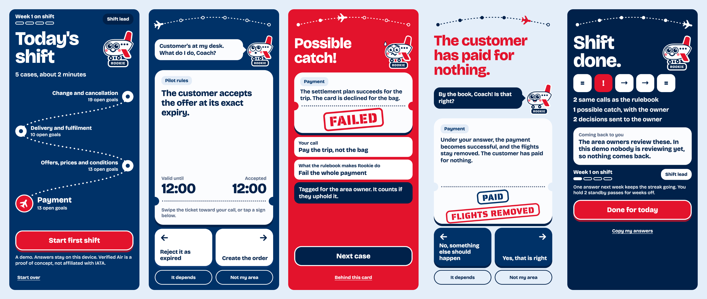

# Verified Air review game

A phone game for reviewing the [Verified Air](https://github.com/samdengler/verified-air) rules. You coach Rookie, a little jet and new hire who follows the rulebook to the letter. Each case takes a swipe, and the biggest moment in the game is catching the rulebook out.

The game has its own Lean model. The screens, the Kiro specs, the design tokens and the tests are all built from it. It is a proof of concept, not affiliated with IATA.



## Run it

```sh
npm start
# then open http://<this computer's address>:8010 on a phone on the same Wi-Fi
```

Swipe a ticket toward your call, or tap a sign. On a keyboard, use the left and right arrows, 1 to 4 for a list of choices, D for "It depends" and N for "Not my area".

To check a phone, open "Behind this card" on any result and run the check. It replays every case the model wrote through the engine running on that device.

## The model

| Part | Where | What it holds |
| --- | --- | --- |
| The game | `model/Game/` | Shifts, answers, titles, the streak, crews and evidence, with their theorems |
| The design system | `model/Design/` | Tokens and rules, with WCAG contrast computed exactly |
| The link to the rules | `connect/Deck.lean` | The only Lean that sees both this model and the airline rules |
| The Rust proof | `verify/RustGame.lean` | The Rust engine equals the model |

Neither model imports the other. A card's outcome is the rule's own value, and the most the game produces is the text of an `@[confirmed]` attribute for a modeller to review. An answer changes no status.

## What is generated

`npm run model` rebuilds the model, so every theorem is checked again, and writes these. Change the model, never these files.

| Output | From |
| --- | --- |
| `.kiro/specs/` | The model's values and the compiled theorems. No docstring is parsed, and it stops if a named theorem is missing or rests on `sorry` |
| `vectors/engine.jsonl` | Every small combination of inputs, with the model's answers |
| `design/` | CSS, W3C design tokens, Swift, Kotlin, documentation and the UI check expectations |
| `web/tokens.css`, `web/model.js`, `web/engine.js`, `web/vectors.txt`, `web/lean/` | Copied in by `scripts/sync-web.sh` |
| `web/deck.js` | `scripts/export_deck.py`, from `deck/pilot.toml` and the verified-air build |

## The engines

The page keeps no rules. It asks an engine, and it draws what comes back.

| Engine | Where | What it rests on |
| --- | --- | --- |
| Lean, the app's engine | `engines/lasm` | The model's own source, compiled with Lasm. Lean's compiler and Lasm are trusted |
| JavaScript, the fallback | `engines/js` | Tested against every vector, with nothing proving it |
| Rust, for comparison | `engines/rust` | Proved equal to the model. Charon, Aeneas, rustc and LLVM are trusted |

`side-by-side/` runs all three next to each other: `npm run side-by-side`, then open `http://127.0.0.1:8011/side-by-side/`.

`scripts/build-lasm.sh` runs Lasm only inside a throwaway container.

## Tests

```sh
npm test                     # the page's source, the vectors in Node, the deck exporter
npm run e2e                  # both shifts with real touch events in headless Chrome. SIZE=320x568 for another screen
npm run test:browsers        # Chromium, Firefox and WebKit: the real app, the design rules on every screen, the side-by-side page
scripts/check-connected.sh   # the Rust proof and the deck, against a built ../verified-air
```

`npm run test:browsers` fails on any design finding, so a forbidden colour pair or a small touch target stops it.

## What is demo only

- **Answers stay on the device.** There is no sign-in and no answer service. "Copy my answers" gives the JSON a service would receive.
- **Nobody reviews yet.** No catch can come back upheld, so titles stay at Shift lead.
- **The drift card is illustrative,** and it says so on the card.
- **Decision choices are unreviewed drafts.** The sources leave these questions open.
- **Crews are modelled and not built.**
- **Nothing has run on a real phone in testing.** WebKit in a container is not Safari on an iPhone.

The colours follow Delta's blue and red, as listed by third-party palette sites. No screen carries Delta's name or logo.
