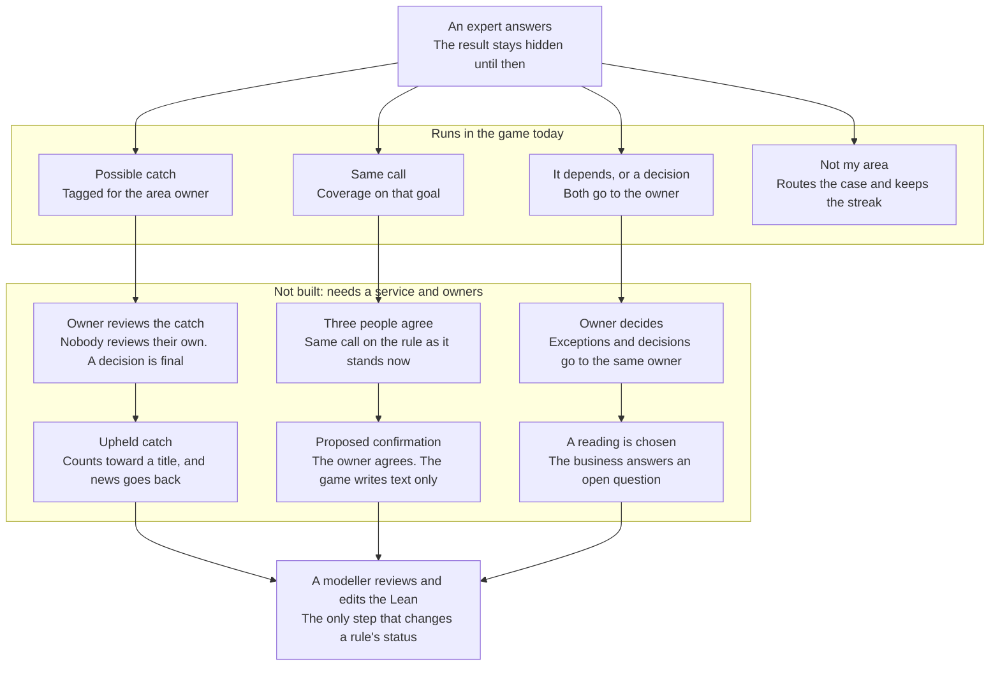

# How Gate Check applies the strategy

## Experts check the rules five cases at a time

Gate Check gets airline experts to test whether a written rule does what the business means. Each shift is five cases and about 2 minutes on a phone. [The game is live](https://gatecheck.dengler.io/) as a demo: answers stay on the device, and nobody reviews them yet.

The design follows one idea: **the reward goes to a disagreement that holds up, and answering more earns nothing.** [Points raised volume with no gain in quality](https://glassmanlab.seas.harvard.edu/annotated_works/mekler17.pdf) in the closest study. [A meaningful task raised output with no significant quality change](https://arxiv.org/abs/1210.0962) in another. None of these studies used airline experts, so a pilot has to test the idea.

A formal rule behaves like a literal-minded new hire: it applies the words as written, even when the result is absurd. So the player coaches Rookie, and Rookie's mistakes belong to the rulebook. The game never tells an expert they are wrong.

## Mechanics in the game, from research to build

Twelve of the eighteen mechanics below are fully built. Two more are partly built, and four wait on people or a service that do not exist yet. Built means it runs in the game. Modelled means Lean states and proves the rule, and no screen uses it yet. Planned means a mockup or an idea. Each guard is a theorem in `model/Game/` or `model/Design/`, and a test fails if a theorem named here disappears.

| Mechanic | Where it comes from | What Gate Check does | Guard in the model | Status |
| --- | --- | --- | --- | --- |
| Tour | New players need the role explained before their first real case | A practice run on a real rule that is in no shift, so it gives no case away. Nothing it does is recorded | None needed: a test checks it | Built |
| Character | [Duolingo's cast](https://blog.duolingo.com/building-character/) and [game fiction](https://eric.ed.gov/?id=EJ1245270) | Rookie, a little jet and new hire, reacts to every answer | None needed | Built |
| A response to each answer | [Lean's constant feedback](https://leodemoura.github.io/static/files/SNU.pdf) | Colour, a landing stamp, motion and vibration where the phone allows it. A possible catch is the biggest moment | `catch_is_loudest`, `red_means_the_biggest_moment` | Built |
| Stakes on the card | [Meaning raises output](https://arxiv.org/abs/1210.0962) | Times, amounts and the count of dependent cards sit on the ticket, computed by the build. A follow-up shows what your answer causes | `follow_up_needs_a_call` | Built |
| Short shift | Attention is the scarce resource | Five cases with no timer, and then the game stops | `new_respects_limit`, `every_shift_finishes` | Built |
| Blind call | A reward for being right teaches agreement | A case shows nothing about the rule's result until you answer | `face_hides_outcome` | Built |
| Swapped sides | Habit can replace reading | Answers change sides between cases, and a yes stays on the right | `sides_balance_across_seeds`, `yes_stays_on_the_right` | Built |
| Ways out | [Fixation on the game hurts](https://arxiv.org/abs/2203.16175) | "It depends" and "Not my area" work on every case, at no cost | `escapes_always_work`, `no_dead_ends` | Built |
| Check cards | A direct test of care | A rule changed to be wrong. Flagging it says so | `recording_keeps_title` | Built |
| Route map | [Duolingo's path](https://blog.duolingo.com/new-duolingo-home-screen-design/) and Lean's goals left | A route across the areas, with open goals counted by the build | None needed | Built |
| Weekly streak | [Duolingo's streak](https://blog.duolingo.com/improving-the-streak) | One case a week keeps it, and "Not my area" counts | `one_answer_extends` | Built, on the device |
| Standby passes | [Streak Freeze](https://blog.duolingo.com/how-duolingo-streak-builds-habit/) | Two passes cover weeks off automatically | `pass_protects_streak`, `passes_never_grow` | Built, on the device |
| Catches in place of XP | [Points raise volume with no gain in quality](https://glassmanlab.seas.harvard.edu/annotated_works/mekler17.pdf) | A disagreement is tagged for the area owner, and it earns credit only if upheld | `unupheld_catch_earns_nothing`, `finder_cannot_review`, `review_is_final` | Tagging built. Owner review modelled |
| Titles in place of leagues | [Competition drives misuse](https://arxiv.org/abs/2203.16175) | Shift lead, Duty manager and Station manager need upheld catches and check cards. A title is never lost | `answering_keeps_title`, `title_never_falls` | Shown, and stays at Shift lead until catches can be upheld |
| Crew quest and board | [Friends Quests](https://blog.duolingo.com/friends-quests/) and [competition with collaboration](https://eric.ed.gov/?id=EJ1245270) | A weekly crew target. The split shows once nobody is still waiting, with a deadline | `chosen_rule_cannot_stall`, `not_my_area_holds_nobody_up` | Modelled |
| Crew guess | [Peer prediction](https://bcs.mit.edu/news/better-wisdom-crowds) | One tap guesses what the crew will say | `choices_stay_hidden` | Modelled |
| News about a catch | [Answers must not vanish](https://arxiv.org/abs/1210.0962), and [Duolingo's cap on notifications](https://www.lennysnewsletter.com/p/how-duolingo-reignited-user-growth) | "Your catch was upheld", at most twice a week | None yet | Planned |
| Try to break it | [Foldit](https://www.washington.edu/news/2011/09/19/gamers-succeed-where-scientists-fail) | Sliders run the real refund rule on the phone | None yet | Planned |

## Mechanics Gate Check leaves out

Each mechanic below is left out because it rewards speed, volume or agreement, which are the things that would make an expert's answer worth less.

| Left out | Reason |
| --- | --- |
| Points or XP for answering | [More answers came with no gain in quality](https://glassmanlab.seas.harvard.edu/annotated_works/mekler17.pdf). `answering_keeps_title` proves that answering more cannot change a title |
| Leagues, promotion and personal leaderboards | [Competitiveness was a main cause of misuse](https://arxiv.org/abs/2203.16175) on Duolingo. Titles are earned once and kept |
| A big reward for agreeing with the rule | It would teach experts to agree with the model. A same call gets a modest screen, proved by `same_call_is_quieter_than_catch` |
| Being told you are wrong | The expert knows the work and the rule is under test. A mismatch is called a possible catch |
| Hearts or energy | They punish the answers we want |
| Gems, chests and XP boosts | Multipliers reward volume, and a shop offers nothing an expert wants |
| Timers | Going fast earns nothing, and a time limit would push people to guess |
| Notifications that nag | [Duolingo caps its own volume](https://www.lennysnewsletter.com/p/how-duolingo-reignited-user-growth) because the channel can be spoiled. Gate Check would send only real news |
| Sound effects | Removed on 2026-11-05 as a product choice. Colour, the stamp and motion carry the feedback |

## Rookie and the reversed role

The expert teaches and the character learns, which reverses Duolingo and suits senior people better than being tested. Rookie calls the player Coach, and asks "What do I do, Coach?" in place of a quiz question. The humour is computed: "The customer has paid for nothing" is what the rule really does, so every joke is also evidence.

Rookie is a little jet with round, open eyes in every mood, and no cap. An earlier version, a rubber stamp with closed curved eyes and a cap, could read as an ethnic caricature, so a test now holds the eyes open. The stamps that land on each ticket keep the rubber-stamp joke.

| Answer | Screen | Rookie | What it earns |
| --- | --- | --- | --- |
| Disagrees with the rulebook | Red, "Possible catch!" | Flustered | Credit if the area owner upholds it |
| Flags a check card | Red, "Good eye." | Happy | A check card passed |
| Same call as the rulebook | Bright blue, "Same call." | Happy | Coverage on that goal |
| Answers a decision | Navy, "Sent to the owner." | Looking up | An answer for the owner, shown with how many cards depend on it |
| It depends | Blue, "Noted." | Looking up | An exception for the owner, at no cost |
| Not my area | Moves to the next case | No reaction | Routes the case and keeps the streak |

A pilot should run Rookie on and off in alternating weeks, because senior staff may find a cartoon silly. A plain version needs only Rookie's speech removed.

## From a swipe to a rule

An answer changes no rule. Only a modeller's Lean edit does, after an owner's decision, and the most the game does is write the text of a proposed confirmation for a modeller to review.

Only the top band runs today, so every answer currently stops on the device. `no_proposal_without_owner`, `same_person_counts_once` and `stale_answers_do_not_count` prove the rules for the proposal, and `connect/Deck.lean` is the only Lean that sees both the game and the airline rules.

## Pilot measures and stop signals

None of these has been run, because no expert has played the game yet. A pilot of 20 to 50 experts cannot detect small effects, so it should watch a few large signals and stop any mechanic that lowers answer quality. The stop signals are proposals, to be set with the modellers.

| Measure | What it shows | Proposed stop signal | Recorded today |
| --- | --- | --- | --- |
| Week 4 return: experts active in weeks 2 and 3 who answer in week 4 | Whether people come back | Below 50% | No, needs a service |
| Check cards flagged | Care, since each one is a rule changed to be wrong | Lower with game features on than off | On the device |
| Catches upheld by owners | Falls if people chase catches | Below 1 in 4 | No, needs owners |
| Share of "It depends" | Falls if the game pushes false certainty | Falls by half after a mechanic is added | On the device |
| Same answer when a case repeats weeks later | Whether answers are stable | Below 80% | No, needs a service |
| Time on each case | Falls if people race | Median halves | On the device |
| "Would you show this to your director?" | Tone, asked once in week 2 | A majority says no | No |

The next test comes before any of this: five experts playing on real phones. "Copy my answers" on the shift report gives the JSON a service would receive, so that test can use the on-device figures.

## Sources

Pages were opened on 2026-11-05, and Duolingo's figures are self-reported.

- Mekler, Bruhlmann, Tuch and Opwis, [Towards understanding the effects of individual gamification elements](https://glassmanlab.seas.harvard.edu/annotated_works/mekler17.pdf), 2017
- Chandler and Kapelner, [Breaking Monotony with Meaning](https://arxiv.org/abs/1210.0962), 2013
- Sailer and Homner, [The gamification of learning: a meta-analysis](https://eric.ed.gov/?id=EJ1245270), 2020
- Hadi Mogavi et al., [When Gamification Spoils Your Learning](https://arxiv.org/abs/2203.16175), 2022
- Prelec, Seung and McCoy, reported in [A better wisdom of crowds](https://bcs.mit.edu/news/better-wisdom-crowds), 2017
- [Gamers succeed where scientists fail](https://www.washington.edu/news/2011/09/19/gamers-succeed-where-scientists-fail), University of Washington, 2011, on Foldit
- Leo de Moura, [The Lean Theorem Prover and the Formalization of Mathematics](https://leodemoura.github.io/static/files/SNU.pdf), 2025
- Jorge Mazal, [How Duolingo reignited user growth](https://www.lennysnewsletter.com/p/how-duolingo-reignited-user-growth), Lenny's Newsletter
- Duolingo blog: [Improving the streak](https://blog.duolingo.com/improving-the-streak), [the streak's research](https://blog.duolingo.com/how-duolingo-streak-builds-habit/), [Friends Quests](https://blog.duolingo.com/friends-quests/), [Building character](https://blog.duolingo.com/building-character/) and [the learning path](https://blog.duolingo.com/new-duolingo-home-screen-design/)
